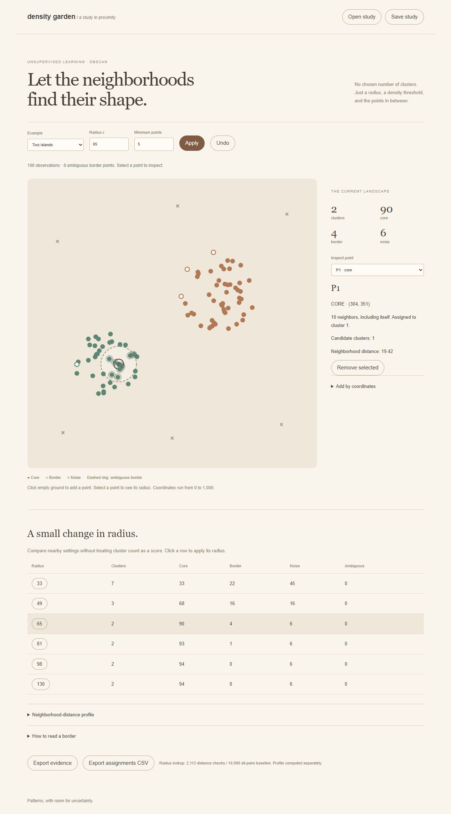

# Density Garden

An interactive DBSCAN workbench for synthetic 2D point clouds. Inspect inclusive neighborhoods, core components, ambiguous border assignments, radius sensitivity, and a sorted neighborhood-distance profile. Add and remove points, undo edits, and export reproducible studies and evidence.



## Run

```sh
python run.py --port 8000
```

Open http://127.0.0.1:8000. Python 3.10+ serves a fixed set of static assets; clustering runs in a browser module worker. There are no runtime packages, external services, or uploads. Node 22+ runs the tests.

## Explore

The default deterministic 100-point example has two dense islands and six distant observations. At radius 65 and minimum-points 5 it produces 2 clusters, 90 core points, 4 border points, and 6 noise points. Radius lookup performs 2,112 exact squared-distance checks instead of the 10,000 all-pairs baseline; the separate distance profile still evaluates all pairs.

Select a point on the plot or in the list. Keyboard Enter/Space also selects plotted points. Its radius and neighbors are highlighted. Click empty ground or use **Add by coordinates** to insert a point. Remove the selected point, undo up to 50 changes, or apply a radius from the sensitivity table. Parameter edits take effect when **Apply** is pressed; exports describe the last applied study.

**The ambiguous border** is a nine-point example with two core components. `Bridge` touches one core point from each component, but is not itself core. It has two candidate clusters and does not join the components. The default assignment chooses the first component.


**Coincident observations** shows that different IDs at the same coordinates remain distinct observations. Three coincident points meet a threshold of three; the distant fourth point is noise.

## Semantics

Neighborhoods include the point itself and all points at Euclidean distance **at most** ε. A point is core when its neighborhood count is at least `minPts`. Connected components of the core-only graph determine clusters. Non-core points are assigned to a neighboring core component, or classified as noise when none exists.

Ambiguous border points retain every candidate cluster in the evidence. Assignment uses the lowest component number; components are numbered by their first core point in input order. This resolves the usual order dependence explicitly. Reordering may change that assignment and numeric labels without changing the core components.

A spatial grid of cell width ε limits radius candidates to nine adjacent cells. Integer coordinate differences and squared distances are exact under the input bounds. The neighborhood-distance profile sorts all pairwise distances and uses the `minPts`-th distance **including self**. It is unavailable when the dataset contains fewer than `minPts` observations.

This is a bounded teaching workbench, not a scalable production clustering service. Worst-case neighborhoods and the profile require quadratic work/storage. Coordinates are unscaled synthetic values, not longitude/latitude. Color cycles after six clusters; numeric cluster labels and the point inspector remain authoritative. Cluster count is not an objective to maximize or minimize, and no automatic optimal radius is claimed.

## File format

```json
{"eps":100,"minPts":4,"points":[{"id":"A","x":300,"y":500}]}
```

Studies permit 0–400 points, unique ASCII IDs beginning with a letter (20 characters maximum), integer coordinates 0–1,000, integer ε 1–300, and `minPts` 1–50. Duplicate coordinates are allowed. The schema rejects extra fields. Imports are limited to 100 KB. [The border study](docs/example.json) is ready to open.

Evidence JSON contains the model, every neighbor list, classification, candidate components, distance profile, sensitivity table, and lookup counts. JSON cluster numbers are zero-based; the UI and CSV display one-based cluster numbers. CSV noise assignments are blank, and multiple candidate cluster numbers are separated by semicolons. Save/open operates on study JSON, not evidence JSON. No local data is persisted automatically.

## Verification

```sh
npm test
npm run check
python -m unittest discover -s tests -v
```

Seven JavaScript tests compare the spatial-grid implementation against an independent all-pairs/component oracle on 300 generated clouds; test ambiguous borders, reordering, coincident observations, inclusive boundaries, empty datasets, radius monotonicity, and strict bounds. The Python test checks HTTP asset isolation and loopback Host handling. CI runs Node 22/24 on Linux and Node 24 on Windows.

Browser verification covers keyboard selection, removal/undo, invalid parameters, boundary coordinates, duplicate observations, study round trips, and JSON/CSV exports. An independent Python replay verified all nine neighborhoods, both core components, the ambiguous border, and every CSV assignment in the exported example.

Algorithm reference: Ester, Kriegel, Sander, and Xu, [A Density-Based Algorithm for Discovering Clusters in Large Spatial Databases with Noise](https://cdn.aaai.org/KDD/1996/KDD96-037.pdf), KDD 1996. This implementation uses core-component construction and an explicit border tie rule rather than reproducing the paper's traversal code.
